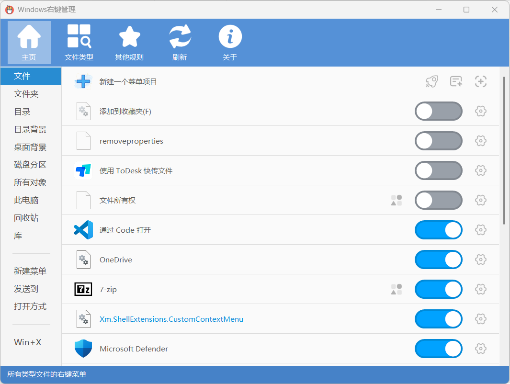

# 右键管理工具

> 一句话简介：基于开源工具 ContextMenuManager（蓝点Lilac）的 Windows 右键菜单管理脚本，可视化增删改各类右键菜单项、自定义新建菜单、清理系统冗余，绿色免安装。

---

## 核心特性

- **全场景右键菜单**：分类管理 文件、目录、目录背景、桌面、磁盘驱动器、"发送到" 等右键菜单项
- **一键增删启禁**：勾选即可启用/禁用菜单项，支持新增、编辑、删除自定义命令
- **自定义新建菜单**：定制右键"新建"子菜单中的文件类型项
- **系统项清理**：同时管理开机启动项、计划任务、系统服务、上下文菜单里的多余项
- **绿色免安装**：单文件 exe，无需安装，改动即时生效（部分需刷新或重启资源管理器）

---

## 脚本演示

---

## 安装方法

本脚本的运行环境与图形化窗口均依赖"不忙脚本盒子"，建议仅通过盒子安装和使用本脚本。

> 前置条件：安装好 [不忙脚本盒子](https://www.bm-box.cn)

* 打开盒子 → **脚本市场** → 搜索 **「右键管理工具」**
* 点击「安装」

---

## 使用方式

* **直接启动**
  * 在盒子里点击脚本卡片，右键管理工具主界面随即打开
* **右键启动**
  * 在桌面背景空白处右键 → 选择 **右键管理工具**
* **快捷键启动**
  * 在盒子里为本脚本设置全局快捷键，按下即可唤起工具

**操作步骤**

1. 打开后在左侧选择要管理的菜单分类（如"文件""目录背景""新建菜单"等）
2. 右侧列出该类下的所有右键菜单项
3. 勾选/取消勾选可 启用/禁用；选中某项后可 编辑、删除 或 新建自定义项
4. 修改即时写入注册表生效；若界面未刷新，可重启资源管理器或按提示操作

---

## 💡 使用提示

- 工具直接修改注册表，**建议操作前先备份注册表**，避免误删系统关键项
- 拿不准的菜单项优先用"禁用"而非"删除"，便于随时恢复
- 修改"桌面/目录背景"右键项后如未生效，重启一次资源管理器即可
- 本工具仅管理菜单，不涉及不忙脚本盒子自身的右键触发配置

---

## 🖥️ 环境要求

| 项目 | 要求 |
| --- | --- |
| **操作系统** | Windows 10+（32/64 位），支持 Win11 右键菜单 |
| **运行环境** | 需 .NET 运行环境（工具已内嵌，通常无需单独安装） |
| **权限** | 管理部分系统项时需以管理员身份运行 |
